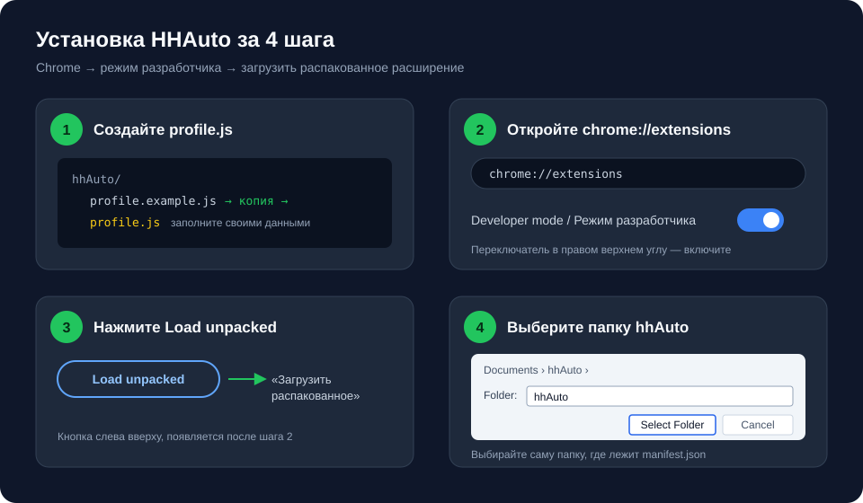
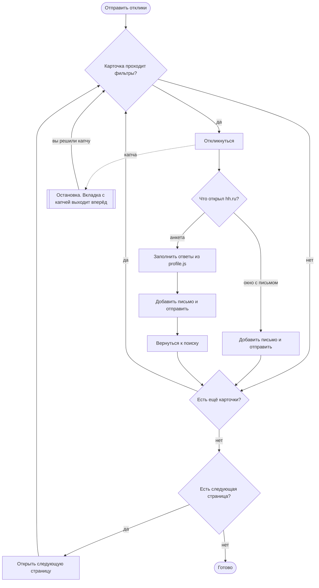

# HHAuto

Chrome-расширение для откликов на вакансии hh.ru: отправляет отклики с сопроводительным письмом, фильтрует вакансии, заполняет анкеты работодателей и переходит по страницам поиска.

Основано на скрипте [AutoSend Letters HH](https://boosty.to/ia-stepanov) (ia-stepanov) и расширяет его.

## Возможности

- **Отклики со страницы поиска.** Кнопка «Отправить отклики» проходит по карточкам и откликается выбранным резюме с письмом. `{#vacancyName}` в письме заменяется на название вакансии.
- **Фильтры.** Слова-исключения в названии (менеджер, продавец, senior…), обязательные слова (разработчик, developer, QA, стажёр…), исключение компаний, только удалённая работа, пропуск вакансий с опытом от 3 лет и похожих вакансий одного работодателя.
- **Анкеты.** Заполняет вопросы, на которые есть ответ в вашем профиле (зарплата, город, GitHub, график, образование, английский и другие), добавляет письмо и отправляет отклик. Для текстовых вопросов без готового ответа пишет нейтральный ответ со ссылкой на GitHub. Для вопросов с вариантами без явного ответа выбирает «Свой вариант» или самый скромный вариант.
- **Переход по страницам.** Когда все вакансии на странице проверены, открывает следующую.
- **Капча.** При капче отправка останавливается, вкладка с капчей выводится на передний план. Капчу решаете вы; после этого отправка продолжается сама.
- **Одна рабочая вкладка.** Во время отправки простаивающие вкладки поиска hh.ru закрываются. Вакансии, резюме и чаты не трогаются.
- **История.** Обработанные вакансии сохраняются и повторно не открываются.

## Установка



**0. Скачайте проект.** Возьмите `hhAuto-v1.0.0.zip` со страницы [Releases](https://github.com/HoPMaLbHblu/hhAuto/releases) и распакуйте, например, в `Documents\hhAuto`. Или клонируйте:

```bash
git clone https://github.com/HoPMaLbHblu/hhAuto.git
```

**1. Создайте `profile.js`.** Скопируйте `profile.example.js` в `profile.js` в той же папке и заполните: ссылки на GitHub и Telegram, зарплату, текст письма, ответы на вопросы анкет. Без этого файла Chrome не загрузит расширение. `profile.js` не попадает в git.

**2. Откройте `chrome://extensions`** и включите **Developer mode** («Режим разработчика») — переключатель справа вверху.

**3. Нажмите Load unpacked** («Загрузить распакованное расширение») слева вверху.

**4. Выберите папку `hhAuto`** — ту, в которой лежит `manifest.json` — и нажмите **Select Folder**.

**Готово.** Откройте поиск вакансий на hh.ru: слева внизу появится зелёный индикатор «HHAuto v1.0.0 включён», справа внизу — кнопка «Отправить отклики».

> После любых изменений в файлах нажмите ↻ у расширения в `chrome://extensions` и обновите страницу hh.ru.

## Как это работает



## Настройка

Кнопка **«Настройки»** слева внизу открывает панель:

- **Резюме.** Основное резюме и отдельное для вакансий с Fullstack в названии. Список резюме появится после того, как вы откроете «Мои резюме» на hh.ru и затем панель настроек.
- **Сопроводительное письмо.** По умолчанию берётся из `profile.js`.
- **Фильтры** по словам в названии, компаниям и удалённой работе.

Ответы для анкет настраиваются в `profile.js`. Правила, по которым вопрос сопоставляется с ответом, лежат в `questionnaire.js` (`RULES`).

Удобный поиск для старта:

```
https://hh.ru/search/vacancy?text=разработчик+OR+developer+OR+QA+OR+стажер&schedule=remote&experience=noExperience&experience=between1And3&items_on_page=50
```

## Файлы

| Файл | Назначение |
|---|---|
| `manifest.json` | Описание расширения (Manifest V3) |
| `content.js` | Отклики, фильтры, история, настройки, переход по страницам, остановка при капче |
| `questionnaire.js` | Заполнение анкет работодателя |
| `heartbeat.js` | Сообщает фоновому скрипту состояние вкладки |
| `background.js` | Закрывает простаивающие вкладки поиска и выводит вкладку с капчей вперёд |
| `profile.example.js` | Пример профиля; скопируйте в `profile.js` |

## Важно

- Нажатие «Отправить отклики» отправляет настоящие отклики от вашего имени.
- Проверьте ответы в `profile.js`: они уходят работодателям как есть. Пишите только правду о своём опыте.
- hh.ru ограничивает массовые отклики и показывает капчу. Расширение капчу не решает.
- После изменения файлов перезагрузите расширение в `chrome://extensions`.
